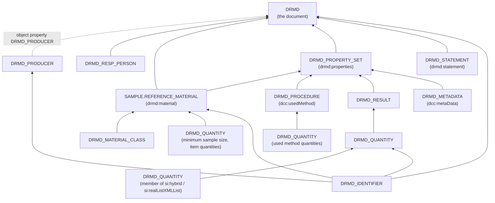

# DRMD datamodel: Digital Reference Material Documents in openBIS

This folder defines the openBIS masterdata for the **Digital Reference Material Document
(DRMD)**, the machine-readable form of a reference material certificate or product information
sheet according to **ISO 33401:2024**. With these object types, every element of a DRMD document
can be stored in the BAM Data Store and written back as a DRMD XML document that passes the DRMD
XSD and the DRMD Schematron rules.

The folder follows "Path B" of the how-to `docs/howtos/extend_masterdata.md` (an application
folder with `object_types.py` and `vocabularies.py`). This README explains the design so that it
can be reviewed and used without reading the code first.

**In short**

- 14 new object types and 7 new vocabularies; all new codes start with `DRMD`, except the sample
  subtype `SAMPLE.REFERENCE_MATERIAL`. No existing type, property or vocabulary is changed.
- One structure serves both document types, the reference material certificate and the product
  information sheet. openBIS marks as mandatory only what both require; everything else is
  checked by rules with the identifiers of the DRMD Schematron (section 6).
- Existing BAM property types are reused where they fit (section 5).
- Tests show that DRMD documents can be read into these objects and written back unchanged, and
  that the written documents pass the DRMD XSD and Schematron (section 15).
- Points that need a decision of the Data Store team are listed in section 16.

## Contents

1. [What the datamodel is for](#1-what-the-datamodel-is-for)
2. [Files](#2-files)
3. [The datamodel at a glance](#3-the-datamodel-at-a-glance)
4. [How the XML document becomes openBIS objects](#4-how-the-xml-document-becomes-openbis-objects)
5. [What was reused and what is new](#5-what-was-reused-and-what-is-new)
6. [Two document types, one datamodel](#6-two-document-types-one-datamodel)
7. [Checking the objects before a document is generated](#7-checking-the-objects-before-a-document-is-generated)
8. [Generating a DRMD at BAM](#8-generating-a-drmd-at-bam)
9. [Values, units and uncertainties](#9-values-units-and-uncertainties)
10. [Text, languages, files and signatures](#10-text-languages-files-and-signatures)
11. [Object type reference](#11-object-type-reference)
12. [Vocabulary reference](#12-vocabulary-reference)
13. [Scope: what is not modelled](#13-scope-what-is-not-modelled)
14. [Ontology mapping notes (BFO/IAO)](#14-ontology-mapping-notes-bfoiao)
15. [Validation and tests](#15-validation-and-tests)
16. [Notes for the review](#16-notes-for-the-review)

---

## 1. What the datamodel is for

The datamodel serves two purposes.

1. **Reading DRMD documents.** A reference material certificate converted from PDF into DRMD XML
   can be stored as openBIS objects, so that LIMS and instruments can use the values.
2. **Writing DRMD documents.** BAM, as a reference material producer, keeps production,
   homogeneity, stability and characterisation data in the Data Store. Reports and certificates
   are to be generated from these data. The datamodel holds everything a DRMD document needs,
   so a generator can write a certificate (or product information sheet) from the objects.

It covers the DRMD schema as published in the DRMD schema repository:

| Specification | Version | Used for |
|---|---|---|
| `drmd.xsd` | 1.0.0, namespace `urn:drmd:schema` | document structure |
| `drmd-business-rules.sch` | 1.0.0, 31 rules (DRMD-, RMC-, PIS-) | rules that differ between the two document types |
| Digital Calibration Certificate, `dcc.xsd` | 3.3.0 | text, contacts, persons, methods, metadata, files |
| Digital System of Units, `SI_Format.xsd` | 2.2.1 | values, units, measurement uncertainty |
| QUDT quantity kinds, `quantitykind.xsd` | 3.0.0 | kind of quantity (`si:quantityTypeQUDT`) |
| XML Signature, `xmldsig-core-schema.xsd` | W3C 2002 | `ds:Signature` (see section 10) |

The names of the DRMD elements and the terms of the DRMD enumerations are kept exactly as in the
schema, because the schema is built on ISO 33401:2024. In particular, every vocabulary term
carries the exact XML token as its label (section 12).

## 2. Files

| Path | Content |
|---|---|
| `bam_masterdata/datamodel/drmd/__init__.py` | package marker |
| `bam_masterdata/datamodel/drmd/object_types.py` | the 14 object types (section 11) |
| `bam_masterdata/datamodel/drmd/vocabularies.py` | the 7 controlled vocabularies (section 12) |
| `bam_masterdata/datamodel/drmd/README.md` | this document |
| `tests/datamodel/drmd_xml.py` | reference mapping XML <-> objects: `xml_to_graph()`, `graph_to_xml()`, `compare_documents()` |
| `tests/datamodel/drmd_rules.py` | `check_graph()`: the Schematron rules and the schema requirements, evaluated on the objects (section 7) |
| `tests/datamodel/drmd_check.py` | command that checks a DRMD XML file against the datamodel (section 15) |
| `tests/datamodel/drmd_validation.py` | optional validation with the DRMD schema repository (`DRMD_SCHEMA_DIR`) |
| `tests/datamodel/test_drmd_datamodel.py` | conventions: codes, descriptions, reused definitions, mandatory flags, vocabularies, masterdata checker |
| `tests/datamodel/test_drmd_mapping.py` | round trips XML -> objects -> XML, number formatting, files, reported content |
| `tests/datamodel/test_drmd_rules.py` | every Schematron rule, cross-checked against the real Schematron file; schema requirements |
| `tests/data/drmd/reference-material-certificate.xml` | worked example of the DRMD schema repository (certificate) |
| `tests/data/drmd/product-information-sheet.xml` | worked example of the DRMD schema repository (product information sheet) |
| `tests/data/drmd/complete-coverage.xml` | test document that uses every element the datamodel holds |

Only `object_types.py` and `vocabularies.py` are masterdata. The Python modules under
`tests/datamodel/` are not part of the `bam_masterdata` package: they are the executable
specification of the mapping and of the rules, used by the tests, and the template for a
production generator (section 8). They are kept out of `bam_masterdata/datamodel/` on purpose,
because every Python module in that folder is read as masterdata by the checker.

No existing file of the repository was changed.

## 3. The datamodel at a glance

Arrows point from parent to child in openBIS. A part of the document is a parent of the object
that contains it ("component -> container"), the same direction as sample -> measurement in the
rest of the BAM datamodel.



Two helper types can be parents of any of these objects:

- `DRMD_TRANSLATION`: the text of one property in another language;
- `DRMD_FILE`: a file embedded in the document; the file itself is a dataset of this object.

## 4. How the XML document becomes openBIS objects

The mapping follows a small set of rules. Section 11 lists every property with its XML path.

1. **Elements that occur once become properties; elements that repeat become objects.** For
   example, `titleOfTheDocument` is the property `DRMD_DOCUMENT_TITLE` of `DRMD`, while every
   `drmd:result` is a `DRMD_RESULT` object.
2. **Repeating parts are parents of the object that contains them** (diagram above). openBIS
   parent links are unordered, so the position of an element in its list is stored in
   `DRMD_POSITION` (1 = first).
3. **The producer is an object property.** A document has exactly one producer, and the same
   producer is used by every document, so `DRMD.DRMD_PRODUCER` points to one `DRMD_PRODUCER`
   object.
4. **The reference material is a sample.** `drmd:material` is `SAMPLE.REFERENCE_MATERIAL`, a
   subtype of the existing `SAMPLE`, so that the material described in the document is the same
   object that production, homogeneity and stability measurements refer to.
5. **Properties blocks are linked to their material.** `drmd:material` has no `@id`; the DRMD
   guidance (chapter "Cross-reference & Identifier Conventions", Convention B) therefore links a
   properties block to an identifier of the material through `@refId`. In openBIS this is a parent
   link `SAMPLE.REFERENCE_MATERIAL -> DRMD_PROPERTY_SET`; the generator writes the `@refId`.
6. **Values and uncertainties are stored as numbers**, units and quantity kinds as the text the
   XML uses (section 9). An `si:hybrid` or `si:realListXMLList` is one `DRMD_QUANTITY` whose
   members are parent quantities.
7. **Text is stored in the primary language** of the document (`DRMD.DRMD_LANGUAGE`); every
   other language is a `DRMD_TRANSLATION` parent (section 10).
8. **Files are datasets.** `drmd:document`, `dcc:file` and `dcc:descriptionData` are
   `DRMD_FILE` objects; the file itself is attached as dataset (section 10).
9. **XML plumbing is grouped.** `@id`, `@refId`, `@refType` and `DRMD_POSITION` are in the
   section "Document Structure" of each object type. They can be left empty when BAM writes a
   document; the generator creates the IDs it needs.
10. **Controlled vocabularies keep the schema tokens.** The term label is the exact XML token,
    the term code is the same token in openBIS notation (`referenceMaterialCertificate` ->
    `REFERENCE_MATERIAL_CERTIFICATE`).

## 5. What was reused and what is new

### 5.1 Reused from the BAM datamodel

| Definition | Used for | Notes |
|---|---|---|
| object type `SAMPLE` | parent type of `SAMPLE.REFERENCE_MATERIAL` | the RM inherits `$NAME`, `DESCRIPTION`, `BAM_OE` (mandatory), storage location, responsible persons |
| `$NAME` | names (`drmd:name`, `dcc:name`) | in every new object type |
| `DESCRIPTION` | `drmd:description`, `dcc:description` | |
| `ALIAS` | short name of the producer | openBIS only |
| `VERSION` | `coreData/documentVersion` | mandatory in `DRMD` |
| `UUID` | `coreData/uniqueIdentifier` | |
| `DATE_EXPIRATION` | `validity/specificTime` | |
| `EMAIL`, `TELEPHONE`, `HOMEPAGE` | `dcc:eMail`, `dcc:phone`, `dcc:link` of contacts and persons | |
| `REFERENCE` | `dcc:reference` of methods and metadata | |
| `RESPONSIBLE_PERSON` (object `PERSON.BAM`) | link from a responsible person of the document to the BAM person record | openBIS only |
| `NOTES`, `$XMLCOMMENTS` | internal notes and comments log | openBIS only, never written to the document |

All reused property types keep their existing code, label, data type and description; a test
checks this (`test_reused_property_types_keep_their_definition`).

### 5.2 Existing types that were considered and not reused

| Existing type | Why it does not fit |
|---|---|
| `DOCUMENT` | `VERSION` and many DRMD properties would have to be mandatory; a subtype cannot make an inherited property mandatory in bam-masterdata (the inherited assignment wins). `DRMD` is therefore its own type. A `DOCUMENT` can still hold the certification report and be linked as parent of `DRMD`. |
| `SUPPLIER` | ELN purchasing type (customer number, order method); its address is free text in two lines, while DCC needs street, number, post code, city and country code as separate elements. |
| `PERSON`, `PERSON.BAM` | a responsible person of a certificate is named as printed, with a function for this document, and may be external; `DRMD_RESP_PERSON` links to `PERSON.BAM` through `RESPONSIBLE_PERSON` where the person is at BAM. |
| `PRODUCT` | a catalogue entry (price, currency); the DRMD describes a batch, which is a sample. A `PRODUCT` can be a parent of the reference material. |
| `PUBLICATION` | can hold the certification report (DOI) and be linked to `DRMD`; the DRMD itself only carries the reference text. |
| `FILE_FORMAT` (dataset property) | means a file format in general; `dcc:mimeType` needs a registered media type, so `DRMD_MIME_TYPE` is new. |
| `ADDRESS` (of `PERSON`) | free text; see `SUPPLIER`. |

### 5.3 New object types

`DRMD`, `DRMD_PRODUCER`, `DRMD_RESP_PERSON`, `DRMD_IDENTIFIER`, `SAMPLE.REFERENCE_MATERIAL`,
`DRMD_MATERIAL_CLASS`, `DRMD_PROPERTY_SET`, `DRMD_RESULT`, `DRMD_QUANTITY`, `DRMD_PROCEDURE`,
`DRMD_METADATA`, `DRMD_STATEMENT`, `DRMD_FILE`, `DRMD_TRANSLATION` (section 11).

### 5.4 New property types

All new property types start with `DRMD_` and have English//German descriptions that name the
XML element they hold. A property type used by several object types (for example
`DRMD_POSITION`, `DRMD_SCHEME`, `DRMD_PERIOD`, the address and the electronic trust properties) has
one definition everywhere it is assigned (`test_shared_property_types_have_one_definition`).

### 5.5 New vocabularies

`DRMD_DOCUMENT_TITLE`, `DRMD_VALIDITY_TYPE`, `DRMD_REF_TYPE`, `DRMD_VALUE_TYPE`,
`DRMD_QUANTITY_ROLE`, `DRMD_UNCERTAINTY_TYPE`, `DRMD_CONFORMITY` (section 12).

## 6. Two document types, one datamodel

DRMD has two document types with one XML structure: the **reference material certificate**
(`referenceMaterialCertificate`, for certified reference materials) and the **product
information sheet** (`productInformationSheet`). They differ only in which elements are required.
The datamodel follows the schema: one set of object types for both, and the document type is the
property `DRMD.DRMD_DOCUMENT_TITLE`.

### 6.1 Why not two object types

Two object types (one per document type, with different mandatory flags) were considered and
rejected:

- most rules involve several objects, e.g. "at least one properties block is certified" or
  "every certified value has an uncertainty"; a mandatory flag acts on one property of one object;
- "mandatory whenever applicable" (`conditional-error`) and "recommended" (`warning`) cannot be
  expressed by a mandatory flag;
- the product information sheet *forbids* something (`isCertified="true"`, PIS-001/PIS-003),
  which openBIS cannot express at all;
- in bam-masterdata a subtype cannot make an inherited property mandatory;
- one document may change type (a product information sheet becomes a certificate after
  certification) without moving the data to another object type.

### 6.2 The approach

1. **openBIS mandatory flags = mandatory in both document types.** These are properties that
   every DRMD needs (table below, column "openBIS").
2. **Everything that depends on the document type, or on several objects, is a rule** with the
   identifier and severity of `drmd-business-rules.sch`. `check_graph()` in
   `tests/datamodel/drmd_rules.py` evaluates these rules on the objects (section 7), so a producer
   sees in openBIS what is missing before a document is generated.
3. **The generated XML is validated with `drmd.xsd` and `drmd-business-rules.sch`.** This is the
   final check; the tests show that `check_graph()` reports exactly the rules that the Schematron
   reports.

### 6.3 Requirements by document type

ISO 33401:2024, Table 1; PIS = product information sheet, RMC = reference material certificate.
"M" = mandatory, "M\*" = mandatory whenever applicable, "R" = recommended, "O" = optional.

| ISO 33401 | Requirement | PIS | RMC | Where in the datamodel | openBIS | Rule (severity) |
|---|---|---|---|---|---|---|
| 5.2.2 | Title of the document | M | M | `DRMD.DRMD_DOCUMENT_TITLE` | mandatory | DRMD-001 (error) |
| 5.2.3 | Unique identifier of the RM | M | M | `DRMD_IDENTIFIER` parent of `SAMPLE.REFERENCE_MATERIAL` | | DRMD-016 (error) |
| 5.2.4 | Name of the RM | M | M | `SAMPLE.REFERENCE_MATERIAL` parent of `DRMD`, `$NAME` | mandatory `$NAME` | DRMD-002, DRMD-007 (error) |
| 5.2.5 | Name and contact details of the producer | M | M | `DRMD.DRMD_PRODUCER` | mandatory | DRMD-010 (error) |
| 5.2.6 | Intended use | M | M | `DRMD.DRMD_INTENDED_USE` | mandatory | DRMD-004 (error) |
| 5.2.7 | Minimum sample size | M\* | M\* | `DRMD_QUANTITY` with role `MINIMUM_SAMPLE_SIZE`, parent of the RM | | DRMD-008 (conditional-error) |
| 5.2.8 | Period of validity | M | M | `DRMD.DRMD_VALIDITY_TYPE` with its date or period | mandatory type | DRMD-012 (error) |
| 5.2.9 | Commutability | M\* | M\* | `DRMD.DRMD_COMMUTABILITY` | | DRMD-013 (conditional-error) |
| 5.2.10 | Storage information | M | M | `DRMD.DRMD_STORAGE_INFORMATION` | mandatory | DRMD-005 (error) |
| 5.2.11 | Instructions for handling and use | M | M | `DRMD.DRMD_HANDLING_INSTRUCTIONS` | mandatory | DRMD-006 (error) |
| 5.2.13 | Document version | M | M | `DRMD.VERSION` | mandatory | DRMD-011 (error) |
| 5.2.14 | Measurement procedures (operationally defined) | M\* | M\* | `DRMD_PROCEDURE` parent of each `DRMD_PROPERTY_SET` | | DRMD-014 (conditional-error) |
| 5.2.15 | Property of interest | M | M | `DRMD_PROPERTY_SET` with `DRMD_RESULT` | | DRMD-003, DRMD-009 (error); PIS-002, RMC-003 (error) |
| 5.3.2 | Description of the material | R | M | `SAMPLE.REFERENCE_MATERIAL.DESCRIPTION` | | RMC-011 (error), PIS-005 (warning) |
| 5.3.3 | Property value and uncertainty | O | M | `DRMD_PROPERTY_SET.DRMD_IS_CERTIFIED` = true; `DRMD_QUANTITY` with `DRMD_UNCERTAINTY_TYPE` | | RMC-002, RMC-006, RMC-007, RMC-008, RMC-009 (error); PIS-001, PIS-003 (error: no certified block in a PIS) |
| 5.3.4 | Metrological traceability | O | M | `DRMD.DRMD_METROLOGICAL_TRACEABILITY` | | RMC-001 (error) |
| 5.3.5 | Name and function of the approving officer | O | M | `DRMD_RESP_PERSON` with `$NAME` and `DRMD_ROLE` | mandatory `$NAME` | RMC-010, RMC-012 (error) |
| 5.4.2 | Measurement procedures (non-operationally defined) | R | R | `DRMD_PROCEDURE` | | RMC-005 (warning) |
| 5.4.3 | Health and safety information | R | R | `DRMD.DRMD_HEALTH_AND_SAFETY` | | DRMD-015 (warning) |
| 5.4.4 | Subcontractors | O | O | `DRMD.DRMD_SUBCONTRACTORS` | | none |
| 5.4.5 | Indicative values | O | O | `DRMD_PROPERTY_SET` with `DRMD_IS_CERTIFIED` = false | | none |
| 5.4.6 | Legal notice | O | O | `DRMD.DRMD_LEGAL_NOTICE` | | none |
| 5.4.7 | Reference to certification report | O | O | `DRMD.DRMD_CERTIFICATION_REPORT` | | none |

Item 5.2.12 (document components) is met by the XML document itself.

Mandatory flags in openBIS, by object type (checked by `test_mandatory_properties`):

| Object type | Mandatory properties |
|---|---|
| `DRMD` | `DRMD_SCHEMA_VERSION`, `DRMD_DOCUMENT_TITLE`, `UUID`, `VERSION`, `DRMD_VALIDITY_TYPE`, `DRMD_PRODUCER`, `DRMD_INTENDED_USE`, `DRMD_STORAGE_INFORMATION`, `DRMD_HANDLING_INSTRUCTIONS` |
| `DRMD_PRODUCER` | `$NAME`, `DRMD_CONTACT_NAME` |
| `DRMD_RESP_PERSON` | `$NAME` |
| `DRMD_IDENTIFIER` | `DRMD_SCHEME`, `DRMD_IDENTIFIER_VALUE` |
| `SAMPLE.REFERENCE_MATERIAL` | `$NAME`, `BAM_OE` (both inherited from `SAMPLE`) |
| `DRMD_MATERIAL_CLASS` | `DRMD_SCHEME`, `DRMD_CLASS_ID` |
| `DRMD_PROPERTY_SET`, `DRMD_RESULT`, `DRMD_PROCEDURE` | `$NAME` |
| `DRMD_QUANTITY` | `DRMD_VALUE_TYPE` |
| `DRMD_FILE` | `DRMD_FILE_NAME`, `DRMD_MIME_TYPE` |
| `DRMD_TRANSLATION` | `DRMD_LANGUAGE`, `DRMD_TARGET_PROPERTY`, `DRMD_TRANSLATED_TEXT` |

`DRMD_METROLOGICAL_TRACEABILITY` and `DRMD_ROLE`, for example, are optional in openBIS although
a certificate needs them: they are not required in a product information sheet, and RMC-001 and
RMC-012 report them for certificates.

## 7. Checking the objects before a document is generated

`check_graph(graph)` in `tests/datamodel/drmd_rules.py` returns a list of findings
(`rule_id`, `severity`, `message`, `object_id`). `is_compliant(findings)` is false if any finding
is an `error` or `conditional-error`, as in `tools/validate.py` of the schema repository.

| Identifier | Source | Meaning |
|---|---|---|
| `DRMD-nnn`, `RMC-nnn`, `PIS-nnn` | `drmd-business-rules.sch` | same identifier, severity and scope as the Schematron assertion; each check in the code names the XPath it mirrors |
| `XSD-...` | `drmd.xsd`, DCC, D-SI | the generated document would not be valid against the XSD |
| `MODEL-...` | this datamodel | the objects cannot be written unambiguously; values would be left out or could not be read back |
| `DSI-SIGNIFICANT-DIGIT` | D-SI | the value has digits below `si:significantDigit` (warning) |
| `BP-MATERIAL-LINK` | DRMD guidance, chapter 10.2 | in a document with several materials, a properties block is not linked to its material (warning) |

Checks beyond the Schematron rules:

| Identifier | Severity | Condition |
|---|---|---|
| `XSD-SCHEMA-VERSION` | error | `DRMD_SCHEMA_VERSION` is not `major.minor.patch` |
| `XSD-VALIDITY` | error | `SPECIFIC_TIME` without `DATE_EXPIRATION`, or `TIME_AFTER_DISPATCH` without `DRMD_PERIOD` |
| `XSD-NOT-EMPTY` | error | a text property is set to an empty text |
| `XSD-LANGUAGE`, `XSD-COUNTRY-CODE`, `XSD-DURATION`, `XSD-DATE-TIME` | error | ISO 639-1, ISO 3166-1 alpha-2, ISO 8601 duration, date and time |
| `XSD-PRODUCER-ADDRESS` | error | the producer has no address element (`dcc:location` needs one) |
| `XSD-RESULT-DATA` | error | a result has no quantity |
| `XSD-QUANTITY-VALUE` | error | a D-SI value without value or unit; an `si:hybrid` or `si:realListXMLList` without suitable members |
| `XSD-UNCERTAINTY` | error | an uncertainty type without its values; coverage factor below 1; coverage probability outside 0 to 1 |
| `XSD-FILE` | error | a `DRMD_FILE` without file; more than one description file of a contact |
| `XSD-XML-ID`, `XSD-XML-REF-ID` | error | duplicate or malformed XML IDs; references to an XML ID that does not exist |
| `MODEL-UNUSED-VALUE` | warning | a value that is not written, e.g. an expiration date with validity `UNTIL_REVOKED` |
| `MODEL-UNCERTAINTY` | error | an `si:constant` with another uncertainty type than `STANDARD_MU` |
| `MODEL-COORDINATES` | error | latitude without longitude, or outside the WGS84 range |
| `MODEL-LIST` | error | elements of an `si:realListXMLList` that cannot form one list |
| `MODEL-QUANTITY-ROLE` | error | a quantity of a reference material without role `MINIMUM_SAMPLE_SIZE` or `ITEM_QUANTITIES` |
| `MODEL-TRANSLATION` | error | a translation in the primary language, or of a property that is not set |
| `MODEL-FILE` | error | a `DRMD_FILE` with several files, or with a target property that the linked object does not have |

`XSD-XML-REF-ID` matters because libxml2, and therefore `tools/validate.py`, does not report an
`@refId` that points to nothing (DRMD guidance, chapter 10.2); Xerces does.

## 8. Generating a DRMD at BAM

### 8.1 Steps

1. **Keep the producer once.** One `DRMD_PRODUCER` object for BAM, with its organisation
   identifier (`DRMD_IDENTIFIER`, scheme `ROR`) as parent. Every `DRMD` points to it.
2. **Create the reference material** as `SAMPLE.REFERENCE_MATERIAL`, linked to its production
   (e.g. as child of the bottling step or of the master batch), with the product code and batch
   number as `DRMD_IDENTIFIER` parents, the minimum sample size as `DRMD_QUANTITY` with role
   `MINIMUM_SAMPLE_SIZE`, and its description.
3. **Create the document**: one `DRMD` object per document version, with the document type,
   UUID, version, validity and statements. Link the reference material, the responsible persons
   and any additional statements as parents.
4. **Add the values**: a `DRMD_PROPERTY_SET` (certified or not) with `DRMD_PROCEDURE`,
   `DRMD_RESULT` and `DRMD_QUANTITY` parents. Link the reference material as parent of the
   property set. The evaluation steps that produced a value can also be parents of its
   `DRMD_QUANTITY`; openBIS allows parents of any type, and the generator ignores them.
5. **Check** the objects with `check_graph()` and correct them in openBIS.
6. **Generate** the XML with `graph_to_xml()` and **validate** it with `tools/validate.py` of the
   schema repository (XSD and Schematron).
7. **Attach the PDF rendition** of the certificate as `DRMD_FILE` (no target property) if the
   document is to be an archival package (DRMD guidance, profile C).
8. **Sign** the final XML (section 10) and store the signed file as dataset of the `DRMD`.

A generator in production reads the `DRMD` object and its parents from openBIS (e.g. with pybis)
into the same structure that `graph_to_xml()` uses (`DrmdGraph`). The functions in
`tests/datamodel/` show the complete mapping and are tested against the schema; they can be moved
into a parser or service when the generator is built.

### 8.2 The BAM-N010 workflow

The workflow drawing for the polypropylene nanoparticle reference material BAM-N010 has several
nodes marked "Object Type?". With this datamodel they map as follows.

| Node in the drawing | openBIS | In the DRMD |
|---|---|---|
| Synthesis, pooling, bottling, pasteurisation | `EXPERIMENTAL_STEP` (existing) | not written; provenance of the material |
| Master batch, bottles `BAM_N010_001` ... `BAM_N010_480` | `SAMPLE` (existing) | not written; units of the material |
| Reference Material BAM-N010 | `SAMPLE.REFERENCE_MATERIAL` | `drmd:material` |
| Characterisation, homogeneity, long-term stability evaluations (u_char, u_hom, u_lts) | `EXPERIMENTAL_STEP` with datasets; result types for these evaluations are not part of the DRMD schema and are not defined here | summarised in `DRMD_CERTIFICATION_REPORT` and the uncertainty statement; can be parents of the certified `DRMD_QUANTITY` |
| Combined uncertainty (D_RM = 174 nm, u_c = 12.8 nm, U = 26 nm, k = 2) | `DRMD_QUANTITY`: `SI_REAL`, value 174, unit `\nano\metre`, kind `Diameter`, `EXPANDED_MU` 26, k 2, coverage probability 0.95 | `drmd:quantity` in a certified `drmd:properties` block |
| Measurement method (DLS, Litesizer 500, ALV 7004) | `INSTRUMENT` (existing) for the steps; `DRMD_PROCEDURE` for the method as stated in the document | `dcc:usedMethod` |
| Report (BAM-N010, August 2026) | `DOCUMENT` (existing) with the PDF as dataset, parent of `DRMD` | `statements/referenceToCertificationReport` |
| RDM for reference materials / Certificate for certified materials | `DRMD` with `DRMD_DOCUMENT_TITLE` = `PRODUCT_INFORMATION_SHEET` or `REFERENCE_MATERIAL_CERTIFICATE` | the document |

### 8.3 Example in Python

The example builds a minimal certificate in memory, checks it and writes it. Run it from the root
of the repository (it imports the modules in `tests/datamodel/`); the test `test_readme_example`
runs this code.

<!-- example: minimal certificate -->
```python
from bam_masterdata.datamodel.drmd.object_types import (
    Drmd,
    DrmdIdentifier,
    DrmdProcedure,
    DrmdProducer,
    DrmdPropertySet,
    DrmdQuantity,
    DrmdRespPerson,
    DrmdResult,
    ReferenceMaterial,
)
from bam_masterdata.metadata.entities import CollectionType
from tests.datamodel.drmd_rules import check_graph
from tests.datamodel.drmd_xml import DrmdGraph, graph_to_xml

BAM_OE = "EXAMPLE_OE"  # organisational unit responsible for the material
collection = CollectionType()


def add(obj, *children):
    """Add an object and link it as parent of the given objects."""
    object_id = collection.add(obj)
    obj.code = object_id
    for child in children:
        collection.add_relationship(object_id, child)
    return object_id


producer = DrmdProducer(
    name="Example Institute for Materials Testing",
    drmd_contact_name="Reference Materials Sales",
    drmd_city="Berlin",
    drmd_country_code="DE",
)
add(producer)
document_id = add(
    Drmd(
        drmd_schema_version="1.0.0",
        drmd_language="en",
        drmd_document_title="REFERENCE_MATERIAL_CERTIFICATE",
        uuid="5d0f8f3c-2b8e-4a55-9a43-0c7b1f2e8d11",
        version="1",
        drmd_validity_type="UNTIL_REVOKED",
        drmd_producer=producer,
        drmd_intended_use="Calibration of particle sizing instruments.",
        drmd_commutability="Commutability was not assessed.",
        drmd_storage_information="Store at 2 °C to 8 °C.",
        drmd_handling_instructions="Invert the bottle gently before use.",
        drmd_metrological_traceability="Traceable to the SI metre.",
        drmd_health_and_safety="No hazards in the supplied form.",
    )
)
add(DrmdRespPerson(name="Dr A. Musterfrau", drmd_role="Head of Division"), document_id)
material_id = add(
    ReferenceMaterial(
        name="Example nanoparticle suspension EXA-N2",
        description="Aqueous suspension in 10 mL glass bottles.",
        bam_oe=BAM_OE,
    ),
    document_id,
)
add(DrmdIdentifier(drmd_scheme="ProductCode", drmd_identifier_value="EXA-N2"), material_id)
add(
    DrmdQuantity(
        drmd_value_type="SI_REAL",
        drmd_quantity_role="MINIMUM_SAMPLE_SIZE",
        drmd_si_value=0.5,
        drmd_si_unit="\\milli\\litre",
    ),
    material_id,
)
values_id = add(
    DrmdPropertySet(name="Certified values", drmd_is_certified=True), document_id
)
collection.add_relationship(material_id, values_id)
add(DrmdProcedure(name="Dynamic light scattering", drmd_norms="ISO 22412"), values_id)
result_id = add(DrmdResult(name="Hydrodynamic diameter"), values_id)
add(
    DrmdQuantity(
        drmd_value_type="SI_REAL",
        drmd_quantity_role="RESULT_DATA",
        drmd_quantity_kind="Diameter",
        drmd_si_value=174.0,
        drmd_si_unit="\\nano\\metre",
        drmd_uncertainty_type="EXPANDED_MU",
        drmd_expanded_uncertainty=26.0,
        drmd_coverage_factor=2.0,
        drmd_coverage_probability=0.95,
    ),
    result_id,
)

graph = DrmdGraph(collection, document_id)
findings = check_graph(graph)  # [] - no rule is violated
xml = graph_to_xml(graph)  # the DRMD document as UTF-8 bytes
```

## 9. Values, units and uncertainties

- **Value types.** `DRMD_VALUE_TYPE` states which value element a quantity uses: `si:real`,
  `si:constant`, `si:hybrid` (the same value in several units; members are parent quantities),
  `si:realListXMLList` (a list of values; one parent quantity per element), `dcc:noQuantity`
  (text instead of a value) or `dcc:charsXMLList` (a list of tokens).
- **Units** are D-SI unit strings such as `\milli\gram\kilo\gram\tothe{-1}` in `DRMD_SI_UNIT`. A
  unit that D-SI cannot express is written as `si:hybrid`: one member in an SI unit, one in the
  conventional unit, and the conventional unit defined in `DRMD_METADATA.DRMD_NON_SI_UNIT` and
  `DRMD_NON_SI_DEFINITION` (DRMD guidance, "Units and quantities").
- **Quantity kinds** are QUDT local names such as `MassFraction` in `DRMD_QUANTITY_KIND`. It is a
  text property, not a vocabulary: QUDT has 1158 quantity kinds, D-SI accepts each as local name
  or as full URI, some names differ only in spelling style (`CENTER-OF-GRAVITY_X` and
  `CenterOfGravity_X`) and would collide as openBIS term codes, and 12 would be longer than the 50
  characters of a term code. `drmd.xsd` validates the name against `quantitykind.xsd`.
- **Significant digit.** Values are stored as numbers, so trailing zeros are not kept by the
  number itself. `DRMD_SIGNIFICANT_DIGIT` (`si:significantDigit`, the power of ten of the last
  significant digit) restores them: 0.5 with -2 is written `0.50`. The uncertainty of such a value
  is written with the same number of decimals. Stored digits are never removed; a value with more
  digits than its significant digit is written as it is and reported (`DSI-SIGNIFICANT-DIGIT`).
  Values of 10^7 or more, and below 10^-4, are written with an exponent (`1.03e9`).
- **Uncertainty.** `DRMD_UNCERTAINTY_TYPE` chooses `standardMU`, `expandedMU` or
  `coverageIntervalMU` of `si:measurementUncertaintyUnivariate`. The deprecated D-SI forms
  `si:expandedUnc` and `si:coverageInterval` are read into the same properties and written in the
  current form.
- **Lists.** In an `si:realListXMLList` every element is a member quantity with its own value,
  unit and uncertainty. D-SI allows one entry for all elements (e.g. one unit); it is applied to
  every member when read, and written once per element. `si:quantityTypeQUDTXMLList` holds one
  quantity kind for the whole list in D-SI 2.2.1, so all members need the same kind.
- **Role.** `DRMD_QUANTITY_ROLE` says in which list a quantity stands: result data, minimum sample
  size, item quantities or used method quantities.

## 10. Text, languages, files and signatures

- **Primary language.** `DRMD.DRMD_LANGUAGE` (ISO 639-1, e.g. `en`) is the language of all text
  properties; it is written as `@lang` on each `dcc:content`.
- **Other languages.** Each translated text is a `DRMD_TRANSLATION` parent of the object, with
  the language, the code of the translated property (`DRMD_TARGET_PROPERTY`, e.g.
  `DRMD_INTENDED_USE` or `$NAME`) and the text.
- **Paragraphs.** A blank line separates paragraphs; each paragraph is one `dcc:content`.
- **Files.** A `DRMD_FILE` is the parent of the object it belongs to, and the file is its
  dataset. `DRMD_TARGET_PROPERTY` names the text the file belongs to (e.g. a safety data sheet
  with `DRMD_HEALTH_AND_SAFETY`, a drawing with `DESCRIPTION` of the material). Without target
  property the file is a `drmd:document` (on `DRMD`) or the `dcc:descriptionData` of a contact
  (on `DRMD_PRODUCER` or `DRMD_RESP_PERSON`).
- **Statements.** The nine named statements of `drmd:statements` are text properties of `DRMD`;
  further statements are `DRMD_STATEMENT` objects with heading, text, files and one LaTeX
  formula.
- **Electronic trust.** The `cryptElectronic...` flags of producer and persons are boolean
  properties. The signature itself (`ds:Signature`) is not a property: it is computed over the
  final XML document by the signing service, after generation and validation, and the signed
  document is stored as dataset.

## 11. Object type reference

XML paths are relative to the element named under "XML"; `coreData` stands for
`drmd:administrativeData/drmd:coreData`, and names without prefix are in the `drmd` namespace.
"(openBIS only)" marks properties that are not written to the document. The section "Document
Structure" holds `DRMD_POSITION` (order in the list), `DRMD_XML_ID` (`@id`), `DRMD_XML_REF_ID`
(`@refId`) and `DRMD_REF_TYPE` / `DRMD_DCC_REF_TYPE` (`@refType`; the closed DRMD list or the open
DCC list, depending on the element).

### `DRMD`

Digital Reference Material Document (DRMD): machine-readable RM certificate or product information sheet according to ISO 33401:2024.

- XML: `drmd:digitalReferenceMaterialDocument` (root)
- Linked: root object; every other object is linked to it directly or through other objects
- Code prefix: `DRMD`

| Property | Label | Data type | Mandatory | Section | XML |
|---|---|---|---|---|---|
| `$NAME` | Name | VARCHAR |  | General Information | (openBIS only) |
| `DRMD_SCHEMA_VERSION` | DRMD schema version | VARCHAR | yes | General Information | `@schemaVersion` |
| `DRMD_LANGUAGE` | Language | VARCHAR |  | General Information | `@lang` of the `dcc:content` in the primary language |
| `DRMD_DOCUMENT_TITLE` | Title of the document | CV `DRMD_DOCUMENT_TITLE` | yes | Core Data | `coreData/titleOfTheDocument` |
| `UUID` | UUID | VARCHAR | yes | Core Data | `coreData/uniqueIdentifier` |
| `VERSION` | Version | VARCHAR | yes | Core Data | `coreData/documentVersion` |
| `DRMD_VALIDITY_TYPE` | Validity type | CV `DRMD_VALIDITY_TYPE` | yes | Validity | `coreData/validity/*` (which of the three) |
| `DATE_EXPIRATION` | Expiration Date | DATE |  | Validity | `coreData/validity/specificTime` |
| `DRMD_DISPATCH_DATE` | Dispatch date | DATE |  | Validity | `coreData/validity/timeAfterDispatch/dispatchDate` |
| `DRMD_PERIOD` | Period | VARCHAR |  | Validity | `coreData/validity/timeAfterDispatch/period` |
| `DRMD_PRODUCER` | Reference material producer | OBJECT `DRMD_PRODUCER` | yes | Reference Material Producer | `administrativeData/referenceMaterialProducer` |
| `DRMD_INTENDED_USE` | Intended use | MULTILINE | yes | Statements | `statements/intendedUse` |
| `DRMD_COMMUTABILITY` | Commutability | MULTILINE |  | Statements | `statements/commutability` |
| `DRMD_STORAGE_INFORMATION` | Storage information | MULTILINE | yes | Statements | `statements/storageInformation` |
| `DRMD_HANDLING_INSTRUCTIONS` | Instructions for handling and use | MULTILINE | yes | Statements | `statements/instructionsForHandlingAndUse` |
| `DRMD_METROLOGICAL_TRACEABILITY` | Metrological traceability | MULTILINE |  | Statements | `statements/metrologicalTraceability` |
| `DRMD_HEALTH_AND_SAFETY` | Health and safety information | MULTILINE |  | Statements | `statements/healthAndSafetyInformation` |
| `DRMD_SUBCONTRACTORS` | Subcontractors | MULTILINE |  | Statements | `statements/subcontractors` |
| `DRMD_LEGAL_NOTICE` | Legal notice | MULTILINE |  | Statements | `statements/legalNotice` |
| `DRMD_CERTIFICATION_REPORT` | Reference to certification report | MULTILINE |  | Statements | `statements/referenceToCertificationReport` |
| `DRMD_COMMENT` | Document comment | MULTILINE |  | Document Comment | `drmd:comment` |
| `NOTES` | Notes | MULTILINE |  | Additional Information | (openBIS only) |
| `$XMLCOMMENTS` | Comments | XML |  | Comments | (openBIS only) |

### `DRMD_PRODUCER`

Reference material producer of a DRMD: name, contact details, postal address and electronic trust capabilities (drmd:referenceMaterialProducer).

- XML: `administrativeData/referenceMaterialProducer`
- Linked: `DRMD` through its object property `DRMD_PRODUCER`
- Code prefix: `DRMD_PROD`

| Property | Label | Data type | Mandatory | Section | XML |
|---|---|---|---|---|---|
| `$NAME` | Name | VARCHAR | yes | General Information | `drmd:name` |
| `ALIAS` | Alternative Name | VARCHAR |  | General Information | (openBIS only) |
| `DRMD_CONTACT_NAME` | Contact name | VARCHAR | yes | Contact Information | `drmd:contact/dcc:name` |
| `EMAIL` | Email address | VARCHAR |  | Contact Information | `drmd:contact/dcc:eMail` |
| `TELEPHONE` | Telephone number | VARCHAR |  | Contact Information | `drmd:contact/dcc:phone` |
| `DRMD_FAX` | Fax number | VARCHAR |  | Contact Information | `drmd:contact/dcc:fax` |
| `HOMEPAGE` | Homepage | HYPERLINK |  | Contact Information | `drmd:contact/dcc:link` |
| `DRMD_STREET` | Street | VARCHAR |  | Postal Address | `drmd:contact/dcc:location/dcc:street` |
| `DRMD_STREET_NO` | Street number | VARCHAR |  | Postal Address | `.../dcc:location/dcc:streetNo` |
| `DRMD_POST_CODE` | Postal code | VARCHAR |  | Postal Address | `.../dcc:location/dcc:postCode` |
| `DRMD_CITY` | City | VARCHAR |  | Postal Address | `.../dcc:location/dcc:city` |
| `DRMD_STATE` | State or region | VARCHAR |  | Postal Address | `.../dcc:location/dcc:state` |
| `DRMD_COUNTRY_CODE` | Country code | VARCHAR |  | Postal Address | `.../dcc:location/dcc:countryCode` |
| `DRMD_POST_OFFICE_BOX` | Post office box | VARCHAR |  | Postal Address | `.../dcc:location/dcc:postOfficeBox` |
| `DRMD_ADDRESS_FURTHER` | Further address information | MULTILINE |  | Postal Address | `.../dcc:location/dcc:further` |
| `DRMD_LATITUDE` | Latitude in [degree] | REAL |  | Postal Address | `.../dcc:positionCoordinates/dcc:positionCoordinate1` (WGS84) |
| `DRMD_LONGITUDE` | Longitude in [degree] | REAL |  | Postal Address | `.../dcc:positionCoordinates/dcc:positionCoordinate2` (WGS84) |
| `DRMD_ELECTRONIC_SEAL` | Electronic seal | BOOLEAN |  | Electronic Trust | `drmd:cryptElectronicSeal` |
| `DRMD_ELECTRONIC_SIGNATURE` | Electronic signature | BOOLEAN |  | Electronic Trust | `drmd:cryptElectronicSignature` |
| `DRMD_ELECTRONIC_TIMESTAMP` | Electronic time stamp | BOOLEAN |  | Electronic Trust | `drmd:cryptElectronicTimeStamp` |
| `NOTES` | Notes | MULTILINE |  | Additional Information | (openBIS only) |
| `$XMLCOMMENTS` | Comments | XML |  | Comments | (openBIS only) |

### `DRMD_RESP_PERSON`

Person responsible for a DRMD, e.g. the approving officer, with name and function (drmd:respPersons/dcc:respPerson).

- XML: `administrativeData/respPersons/dcc:respPerson`
- Linked: parent of `DRMD`
- Code prefix: `DRMD_RESP`

| Property | Label | Data type | Mandatory | Section | XML |
|---|---|---|---|---|---|
| `$NAME` | Name | VARCHAR | yes | General Information | `dcc:person/dcc:name` |
| `RESPONSIBLE_PERSON` | Responsible person | OBJECT `PERSON.BAM` |  | General Information | (openBIS only), link to the BAM person record |
| `DRMD_ROLE` | Function | VARCHAR |  | General Information | `dcc:role` |
| `DESCRIPTION` | Description | MULTILINE |  | General Information | `dcc:description` |
| `DRMD_MAIN_SIGNER` | Main signer | BOOLEAN |  | General Information | `dcc:mainSigner` |
| `EMAIL` | Email address | VARCHAR |  | Contact Information | `dcc:person/dcc:eMail` |
| `TELEPHONE` | Telephone number | VARCHAR |  | Contact Information | `dcc:person/dcc:phone` |
| `DRMD_FAX` | Fax number | VARCHAR |  | Contact Information | `dcc:person/dcc:fax` |
| `HOMEPAGE` | Homepage | HYPERLINK |  | Contact Information | `dcc:person/dcc:link` |
| `DRMD_STREET` | Street | VARCHAR |  | Postal Address | `dcc:person/dcc:location/dcc:street` |
| `DRMD_STREET_NO` | Street number | VARCHAR |  | Postal Address | `.../dcc:location/dcc:streetNo` |
| `DRMD_POST_CODE` | Postal code | VARCHAR |  | Postal Address | `.../dcc:location/dcc:postCode` |
| `DRMD_CITY` | City | VARCHAR |  | Postal Address | `.../dcc:location/dcc:city` |
| `DRMD_STATE` | State or region | VARCHAR |  | Postal Address | `.../dcc:location/dcc:state` |
| `DRMD_COUNTRY_CODE` | Country code | VARCHAR |  | Postal Address | `.../dcc:location/dcc:countryCode` |
| `DRMD_POST_OFFICE_BOX` | Post office box | VARCHAR |  | Postal Address | `.../dcc:location/dcc:postOfficeBox` |
| `DRMD_ADDRESS_FURTHER` | Further address information | MULTILINE |  | Postal Address | `.../dcc:location/dcc:further` |
| `DRMD_LATITUDE` | Latitude in [degree] | REAL |  | Postal Address | `.../dcc:positionCoordinates/dcc:positionCoordinate1` (WGS84) |
| `DRMD_LONGITUDE` | Longitude in [degree] | REAL |  | Postal Address | `.../dcc:positionCoordinates/dcc:positionCoordinate2` (WGS84) |
| `DRMD_ELECTRONIC_SEAL` | Electronic seal | BOOLEAN |  | Electronic Trust | `dcc:cryptElectronicSeal` |
| `DRMD_ELECTRONIC_SIGNATURE` | Electronic signature | BOOLEAN |  | Electronic Trust | `dcc:cryptElectronicSignature` |
| `DRMD_ELECTRONIC_TIMESTAMP` | Electronic time stamp | BOOLEAN |  | Electronic Trust | `dcc:cryptElectronicTimeStamp` |
| `DRMD_POSITION` | Position | INTEGER |  | Document Structure | order in the list |
| `DRMD_XML_ID` | XML ID | VARCHAR |  | Document Structure | `@id` |
| `DRMD_XML_REF_ID` | XML references | VARCHAR |  | Document Structure | `@refId` |
| `DRMD_DCC_REF_TYPE` | DCC reference type | VARCHAR |  | Document Structure | `@refType` |
| `NOTES` | Notes | MULTILINE |  | Additional Information | (openBIS only) |
| `$XMLCOMMENTS` | Comments | XML |  | Comments | (openBIS only) |

### `DRMD_IDENTIFIER`

Identifier of a DRMD document, organisation, material or property, given as scheme and value (drmd:identifierType).

- XML: `drmd:documentIdentifier`, `drmd:organizationIdentifier`, `drmd:materialIdentifier`, `drmd:propertyIdentifier` (`drmd:identifierType`)
- Linked: parent of `DRMD`, `DRMD_PRODUCER`, `SAMPLE.REFERENCE_MATERIAL` or `DRMD_QUANTITY`; the type of the child decides the list
- Code prefix: `DRMD_ID`

| Property | Label | Data type | Mandatory | Section | XML |
|---|---|---|---|---|---|
| `$NAME` | Name | VARCHAR |  | General Information | (openBIS only) |
| `DRMD_SCHEME` | Scheme | VARCHAR | yes | General Information | `drmd:scheme` |
| `DRMD_IDENTIFIER_VALUE` | Identifier value | VARCHAR | yes | General Information | `drmd:value` |
| `DRMD_LINK` | Link | HYPERLINK |  | General Information | `drmd:link` |
| `DRMD_POSITION` | Position | INTEGER |  | Document Structure | order in the list |
| `DRMD_XML_ID` | XML ID | VARCHAR |  | Document Structure | `@id` |
| `DRMD_XML_REF_ID` | XML references | VARCHAR |  | Document Structure | `@refId` |
| `DRMD_REF_TYPE` | Reference type | CV `DRMD_REF_TYPE` |  | Document Structure | `@refType` |
| `$XMLCOMMENTS` | Comments | XML |  | Comments | (openBIS only) |

### `SAMPLE.REFERENCE_MATERIAL`

Reference material (RM or CRM) described by a DRMD document, typically one batch; name and description are given in $NAME and DESCRIPTION (drmd:material).

- XML: `drmd:materials/drmd:material`
- Linked: parent of `DRMD`, and of each `DRMD_PROPERTY_SET` that describes it
- Code prefix: `SAM.RM`

| Property | Label | Data type | Mandatory | Section | XML |
|---|---|---|---|---|---|
| `$NAME` | Name | VARCHAR | yes | General Information | `drmd:name` |
| `DESCRIPTION` | Description | MULTILINE |  | General Information | `drmd:description` |
| `DRMD_POSITION` | Position | INTEGER |  | Document Structure | order in the list |

### `DRMD_MATERIAL_CLASS`

Classification of a reference material according to a standard, taxonomy or catalogue scheme (drmd:materialClass).

- XML: `drmd:material/drmd:materialClass`
- Linked: parent of `SAMPLE.REFERENCE_MATERIAL`
- Code prefix: `DRMD_MCL`

| Property | Label | Data type | Mandatory | Section | XML |
|---|---|---|---|---|---|
| `$NAME` | Name | VARCHAR |  | General Information | (openBIS only) |
| `DRMD_SCHEME` | Scheme | VARCHAR | yes | General Information | `drmd:reference` |
| `DRMD_CLASS_ID` | Class ID | VARCHAR | yes | General Information | `drmd:classID` |
| `DRMD_LINK` | Link | HYPERLINK |  | General Information | `drmd:link` |
| `DRMD_POSITION` | Position | INTEGER |  | Document Structure | order in the list |
| `DRMD_XML_ID` | XML ID | VARCHAR |  | Document Structure | `@id` |
| `DRMD_XML_REF_ID` | XML references | VARCHAR |  | Document Structure | `@refId` |
| `DRMD_REF_TYPE` | Reference type | CV `DRMD_REF_TYPE` |  | Document Structure | `@refType` |
| `$XMLCOMMENTS` | Comments | XML |  | Comments | (openBIS only) |

### `DRMD_PROPERTY_SET`

Block of property values of a DRMD, certified or informative, with procedures, results and metadata (drmd:propertiesList/drmd:properties).

- XML: `drmd:propertiesList/drmd:properties`
- Linked: parent of `DRMD`
- Code prefix: `DRMD_PSET`

| Property | Label | Data type | Mandatory | Section | XML |
|---|---|---|---|---|---|
| `$NAME` | Name | VARCHAR | yes | General Information | `drmd:name` |
| `DESCRIPTION` | Description | MULTILINE |  | General Information | `drmd:description` |
| `DRMD_IS_CERTIFIED` | Certified values | BOOLEAN |  | General Information | `@isCertified` |
| `DRMD_POSITION` | Position | INTEGER |  | Document Structure | order in the list |
| `DRMD_XML_ID` | XML ID | VARCHAR |  | Document Structure | `@id` |
| `DRMD_XML_REF_ID` | XML references | VARCHAR |  | Document Structure | `@refId`, except the references to materials, which are `SAMPLE.REFERENCE_MATERIAL` parents |
| `DRMD_REF_TYPE` | Reference type | CV `DRMD_REF_TYPE` |  | Document Structure | `@refType` |
| `NOTES` | Notes | MULTILINE |  | Additional Information | (openBIS only) |
| `$XMLCOMMENTS` | Comments | XML |  | Comments | (openBIS only) |

### `DRMD_RESULT`

Result within a block of property values, typically one value or one table (drmd:results/drmd:result).

- XML: `drmd:properties/drmd:results/drmd:result`
- Linked: parent of `DRMD_PROPERTY_SET`
- Code prefix: `DRMD_RES`

| Property | Label | Data type | Mandatory | Section | XML |
|---|---|---|---|---|---|
| `$NAME` | Name | VARCHAR | yes | General Information | `drmd:name` |
| `DESCRIPTION` | Description | MULTILINE |  | General Information | `drmd:description` |
| `DRMD_DATA_AS_LIST` | Data given as list | BOOLEAN |  | General Information | `drmd:data/drmd:list` instead of `drmd:data/drmd:quantity` |
| `DRMD_POSITION` | Position | INTEGER |  | Document Structure | order in the list |
| `DRMD_XML_ID` | XML ID | VARCHAR |  | Document Structure | `@id` |
| `DRMD_XML_REF_ID` | XML references | VARCHAR |  | Document Structure | `@refId` |
| `DRMD_REF_TYPE` | Reference type | CV `DRMD_REF_TYPE` |  | Document Structure | `@refType` |
| `NOTES` | Notes | MULTILINE |  | Additional Information | (openBIS only) |
| `$XMLCOMMENTS` | Comments | XML |  | Comments | (openBIS only) |

### `DRMD_QUANTITY`

Quantity of a DRMD with value, D-SI unit, quantity kind and measurement uncertainty (drmd:quantityType, dcc:primitiveQuantityType).

- XML: `drmd:quantity`, `dcc:itemQuantity`, `dcc:usedMethodQuantity`; also the members of `si:hybrid` and the elements of `si:realListXMLList`
- Linked: parent of `DRMD_RESULT`, `SAMPLE.REFERENCE_MATERIAL` or `DRMD_PROCEDURE`; a member is parent of the `DRMD_QUANTITY` of its `si:hybrid` or `si:realListXMLList`
- Code prefix: `DRMD_QTY`

| Property | Label | Data type | Mandatory | Section | XML |
|---|---|---|---|---|---|
| `$NAME` | Name | VARCHAR |  | General Information | `dcc:name` |
| `DESCRIPTION` | Description | MULTILINE |  | General Information | `dcc:description` |
| `DRMD_VALUE_TYPE` | Value type | CV `DRMD_VALUE_TYPE` | yes | General Information | which value element is used (`si:real`, `si:hybrid`, ...) |
| `DRMD_QUANTITY_ROLE` | Quantity role | CV `DRMD_QUANTITY_ROLE` |  | General Information | the list that holds the quantity |
| `DRMD_SI_LABEL` | SI label | VARCHAR |  | SI Value | `si:label` (`si:labelXMLList`) |
| `DRMD_QUANTITY_KIND` | Quantity kind (QUDT) | VARCHAR |  | SI Value | `si:quantityTypeQUDT` (`si:quantityTypeQUDTXMLList`) |
| `DRMD_SI_VALUE` | Value | REAL |  | SI Value | `si:value` (`si:valueXMLList`) |
| `DRMD_SI_UNIT` | Unit (D-SI) | VARCHAR |  | SI Value | `si:unit` (`si:unitXMLList`) |
| `DRMD_SIGNIFICANT_DIGIT` | Significant digit | INTEGER |  | SI Value | `si:significantDigit` (`si:significantDigitXMLList`) |
| `DRMD_SI_DATE_TIME` | Date and time | TIMESTAMP |  | SI Value | `si:dateTime` (`si:dateTimeXMLList`) |
| `DRMD_UNCERTAINTY_TYPE` | Uncertainty type | CV `DRMD_UNCERTAINTY_TYPE` |  | Measurement Uncertainty | `si:measurementUncertaintyUnivariate/*` |
| `DRMD_STANDARD_UNCERTAINTY` | Standard uncertainty | REAL |  | Measurement Uncertainty | `si:valueStandardMU` |
| `DRMD_EXPANDED_UNCERTAINTY` | Expanded uncertainty | REAL |  | Measurement Uncertainty | `si:valueExpandedMU` |
| `DRMD_COVERAGE_FACTOR` | Coverage factor | REAL |  | Measurement Uncertainty | `si:coverageFactor` |
| `DRMD_COVERAGE_PROBABILITY` | Coverage probability | REAL |  | Measurement Uncertainty | `si:coverageProbability` |
| `DRMD_INTERVAL_MIN` | Coverage interval minimum | REAL |  | Measurement Uncertainty | `si:intervalMin` |
| `DRMD_INTERVAL_MAX` | Coverage interval maximum | REAL |  | Measurement Uncertainty | `si:intervalMax` |
| `DRMD_DISTRIBUTION` | Distribution | VARCHAR |  | Measurement Uncertainty | `si:distribution` |
| `DRMD_NO_QUANTITY_TEXT` | Non-numeric value | MULTILINE |  | Non Numeric Value | `dcc:noQuantity` |
| `DRMD_CHARS_LIST` | Token list | VARCHAR |  | Non Numeric Value | `dcc:charsXMLList` |
| `DRMD_POSITION` | Position | INTEGER |  | Document Structure | order in the list |
| `DRMD_XML_ID` | XML ID | VARCHAR |  | Document Structure | `@id` |
| `DRMD_XML_REF_ID` | XML references | VARCHAR |  | Document Structure | `@refId` |
| `DRMD_DCC_REF_TYPE` | DCC reference type | VARCHAR |  | Document Structure | `@refType` |
| `NOTES` | Notes | MULTILINE |  | Additional Information | (openBIS only) |
| `$XMLCOMMENTS` | Comments | XML |  | Comments | (openBIS only) |

### `DRMD_PROCEDURE`

Measurement procedure used to establish property values or for which the material is intended (drmd:procedures/dcc:usedMethod).

- XML: `drmd:properties/drmd:procedures/dcc:usedMethod`
- Linked: parent of `DRMD_PROPERTY_SET`
- Code prefix: `DRMD_PROC`

| Property | Label | Data type | Mandatory | Section | XML |
|---|---|---|---|---|---|
| `$NAME` | Name | VARCHAR | yes | General Information | `dcc:name` |
| `DESCRIPTION` | Description | MULTILINE |  | General Information | `dcc:description` |
| `DRMD_NORMS` | Normative documents | MULTILINE |  | General Information | `dcc:norm`, one per line |
| `REFERENCE` | References | MULTILINE |  | General Information | `dcc:reference`, one per line |
| `DRMD_LINKS` | Links | MULTILINE |  | General Information | `dcc:link`, one per line |
| `DRMD_POSITION` | Position | INTEGER |  | Document Structure | order in the list |
| `DRMD_XML_ID` | XML ID | VARCHAR |  | Document Structure | `@id` |
| `DRMD_XML_REF_ID` | XML references | VARCHAR |  | Document Structure | `@refId` |
| `DRMD_DCC_REF_TYPE` | DCC reference type | VARCHAR |  | Document Structure | `@refType` |
| `NOTES` | Notes | MULTILINE |  | Additional Information | (openBIS only) |
| `$XMLCOMMENTS` | Comments | XML |  | Comments | (openBIS only) |

### `DRMD_METADATA`

Measurement metadata of a block of property values, e.g. traceability or the definition of a non-SI unit (drmd:measurementMetaData/dcc:metaData).

- XML: `drmd:properties/drmd:measurementMetaData/dcc:metaData`
- Linked: parent of `DRMD_PROPERTY_SET`
- Code prefix: `DRMD_META`

| Property | Label | Data type | Mandatory | Section | XML |
|---|---|---|---|---|---|
| `$NAME` | Name | VARCHAR |  | General Information | `dcc:name` |
| `DESCRIPTION` | Description | MULTILINE |  | General Information | `dcc:description` |
| `DRMD_CONVENTION` | Convention | VARCHAR |  | Measurement Metadata | `dcc:convention` |
| `DRMD_TRACEABLE` | Traceable | BOOLEAN |  | Measurement Metadata | `dcc:traceable` |
| `DRMD_NORMS` | Normative documents | MULTILINE |  | Measurement Metadata | `dcc:norm`, one per line |
| `REFERENCE` | References | MULTILINE |  | Measurement Metadata | `dcc:reference`, one per line |
| `DRMD_LINKS` | Links | MULTILINE |  | Measurement Metadata | `dcc:link`, one per line |
| `DRMD_DECLARATION` | Declaration | MULTILINE |  | Measurement Metadata | `dcc:declaration` |
| `DRMD_VALID` | Valid | BOOLEAN |  | Measurement Metadata | `dcc:valid` |
| `DRMD_METADATA_DATE` | Date | DATE |  | Measurement Metadata | `dcc:date` |
| `DRMD_PERIOD` | Period | VARCHAR |  | Measurement Metadata | `dcc:period` |
| `DRMD_CONFORMITY` | Conformity | CV `DRMD_CONFORMITY` |  | Measurement Metadata | `dcc:conformity` |
| `DRMD_NON_SI_UNIT` | Non-SI unit | VARCHAR |  | Measurement Metadata | `dcc:nonSIUnit` |
| `DRMD_NON_SI_DEFINITION` | Definition of the non-SI unit | MULTILINE |  | Measurement Metadata | `dcc:nonSIDefinition` |
| `DRMD_POSITION` | Position | INTEGER |  | Document Structure | order in the list |
| `DRMD_XML_ID` | XML ID | VARCHAR |  | Document Structure | `@id` |
| `DRMD_XML_REF_ID` | XML references | VARCHAR |  | Document Structure | `@refId` |
| `DRMD_DCC_REF_TYPE` | DCC reference type | VARCHAR |  | Document Structure | `@refType` |
| `NOTES` | Notes | MULTILINE |  | Additional Information | (openBIS only) |
| `$XMLCOMMENTS` | Comments | XML |  | Comments | (openBIS only) |

### `DRMD_STATEMENT`

Additional statement on the handling and use of the material that has no dedicated element (drmd:statements/drmd:statement).

- XML: `drmd:statements/drmd:statement`
- Linked: parent of `DRMD`
- Code prefix: `DRMD_STMT`

| Property | Label | Data type | Mandatory | Section | XML |
|---|---|---|---|---|---|
| `$NAME` | Name | VARCHAR |  | General Information | `dcc:name` (heading) |
| `DRMD_STATEMENT_TEXT` | Statement text | MULTILINE |  | General Information | `dcc:content` |
| `DRMD_FORMULA_LATEX` | Formula (LaTeX) | MULTILINE |  | General Information | `dcc:formula/dcc:latex` |
| `DRMD_POSITION` | Position | INTEGER |  | Document Structure | order in the list |
| `DRMD_XML_ID` | XML ID | VARCHAR |  | Document Structure | `@id` |
| `DRMD_XML_REF_ID` | XML references | VARCHAR |  | Document Structure | `@refId` |
| `DRMD_DCC_REF_TYPE` | DCC reference type | VARCHAR |  | Document Structure | `@refType` |
| `NOTES` | Notes | MULTILINE |  | Additional Information | (openBIS only) |
| `$XMLCOMMENTS` | Comments | XML |  | Comments | (openBIS only) |

### `DRMD_FILE`

File embedded in a DRMD; the file itself is attached to this object as dataset. With a target property it belongs to that text of the linked object (dcc:file), without one it is the document embedded in the DRMD (drmd:document) or the description data of a contact (dcc:descriptionData).

- XML: `drmd:document`, `dcc:file`, `dcc:descriptionData` (`dcc:byteDataType`)
- Linked: parent of the object whose text, contact or document holds the file
- Code prefix: `DRMD_FILE`

| Property | Label | Data type | Mandatory | Section | XML |
|---|---|---|---|---|---|
| `$NAME` | Name | VARCHAR |  | General Information | `dcc:name` |
| `DESCRIPTION` | Description | MULTILINE |  | General Information | `dcc:description` |
| `DRMD_FILE_NAME` | File name | VARCHAR | yes | General Information | `dcc:fileName` |
| `DRMD_MIME_TYPE` | Media type | VARCHAR | yes | General Information | `dcc:mimeType` |
| `DRMD_TARGET_PROPERTY` | Target property | VARCHAR |  | General Information | the text element that holds the `dcc:file`; empty for `drmd:document` and `dcc:descriptionData` |
| `DRMD_POSITION` | Position | INTEGER |  | Document Structure | order in the list |
| `DRMD_XML_ID` | XML ID | VARCHAR |  | Document Structure | `@id` |
| `DRMD_XML_REF_ID` | XML references | VARCHAR |  | Document Structure | `@refId` |
| `DRMD_DCC_REF_TYPE` | DCC reference type | VARCHAR |  | Document Structure | `@refType` |
| `NOTES` | Notes | MULTILINE |  | Additional Information | (openBIS only) |
| `$XMLCOMMENTS` | Comments | XML |  | Comments | (openBIS only) |

### `DRMD_TRANSLATION`

Translation of a text property of a DRMD object into another language (dcc:content with @lang).

- XML: `dcc:content` with a `@lang` other than the primary language
- Linked: parent of the object whose text is translated
- Code prefix: `DRMD_TRL`

| Property | Label | Data type | Mandatory | Section | XML |
|---|---|---|---|---|---|
| `$NAME` | Name | VARCHAR |  | General Information | (openBIS only) |
| `DRMD_LANGUAGE` | Language | VARCHAR | yes | General Information | `@lang` |
| `DRMD_TARGET_PROPERTY` | Target property | VARCHAR | yes | General Information | the property whose text is translated |
| `DRMD_TRANSLATED_TEXT` | Translated text | MULTILINE | yes | General Information | `dcc:content` |
| `$XMLCOMMENTS` | Comments | XML |  | Comments | (openBIS only) |

## 12. Vocabulary reference

The label of each term is the token written to the XML document; terms are in schema order.

| Vocabulary | Schema source | Terms (code = XML token) |
|---|---|---|
| `DRMD_DOCUMENT_TITLE` | `drmd:titleOfDocumentType` | `PRODUCT_INFORMATION_SHEET` = `productInformationSheet`, `REFERENCE_MATERIAL_CERTIFICATE` = `referenceMaterialCertificate` |
| `DRMD_VALIDITY_TYPE` | choice in `drmd:ValidityType` | `UNTIL_REVOKED` = `untilRevoked`, `TIME_AFTER_DISPATCH` = `timeAfterDispatch`, `SPECIFIC_TIME` = `specificTime` |
| `DRMD_REF_TYPE` | `drmd:refTypesType` | `BASIC_CERTIFICATE_IDENTIFICATION` = `basic_certificateIdentification`, `BASIC_MEASURED_VALUE` = `basic_measuredValue` |
| `DRMD_VALUE_TYPE` | choice in `dcc:primitiveQuantityType` (without the complex types) | `SI_REAL` = `si:real`, `SI_HYBRID` = `si:hybrid`, `SI_CONSTANT` = `si:constant`, `SI_REAL_LIST_XML_LIST` = `si:realListXMLList`, `DCC_NO_QUANTITY` = `dcc:noQuantity`, `DCC_CHARS_XML_LIST` = `dcc:charsXMLList` |
| `DRMD_QUANTITY_ROLE` | lists that hold quantities (`drmd:data`, `drmd:minimumSampleSize`, `drmd:itemQuantities`, `dcc:usedMethodQuantities`) | `RESULT_DATA` = `data`, `MINIMUM_SAMPLE_SIZE` = `minimumSampleSize`, `ITEM_QUANTITIES` = `itemQuantities`, `USED_METHOD_QUANTITIES` = `usedMethodQuantities` |
| `DRMD_UNCERTAINTY_TYPE` | choice in `si:measurementUncertaintyUnivariateType` | `STANDARD_MU` = `standardMU`, `EXPANDED_MU` = `expandedMU`, `COVERAGE_INTERVAL_MU` = `coverageIntervalMU` |
| `DRMD_CONFORMITY` | `dcc:stringConformityStatementStatusType` | `PASS` = `pass`, `FAIL` = `fail`, `CONDITIONAL_PASS` = `conditionalPass`, `CONDITIONAL_FAIL` = `conditionalFail`, `NO_PASS` = `noPass`, `NO_FAIL` = `noFail` |

`DRMD_DOCUMENT_TITLE` and `DRMD_REF_TYPE` have two terms. The BAM guidance suggests a boolean for
vocabularies with two terms; here the terms are the enumerations of `drmd.xsd`, the XML needs the
token, and the schema may add terms in a minor version (`drmd:refTypesType`). 46 vocabularies with
two terms exist in the BAM datamodel already.

## 13. Scope: what is not modelled

The datamodel holds every element of `drmd.xsd` 1.0.0 except the following. `xml_to_graph()`
reports each of them in `DrmdGraph.warnings`, or raises `UnsupportedContentError` where a value
cannot be held without changing its meaning.

| Not modelled | Reason |
|---|---|
| `si:complex`, `si:complexListXMLList`; `si:list`, `si:realList` inside `si:hybrid` | complex values and nested lists do not occur in reference material certificates; raises an error |
| multivariate uncertainty of lists (`si:measurementUncertaintyMultivariateXMLList`, ellipsoidal and rectangular regions) | not used for certified values; raises an error |
| `dcc:metaData` elements `countryCodeISO3166_1`, `validXMLList`, `respAuthority`, `conformityXMLList`, `data`, `location` | DCC calibration features; the DRMD guidance uses `dcc:metaData` for traceability, conventions, validity and non-SI units only |
| heading (`dcc:name`) and formulas inside rich text other than `drmd:statement` | decorative; a statement keeps heading and one LaTeX formula |
| MathML formulas, more than one formula per statement | LaTeX is enough for the formulas of a certificate |
| attributes `@id`, `@refId`, `@refType` of text elements (`dcc:content`, names, descriptions, the nine named statements), of contacts and of coordinates | not used for linking in the DRMD guidance |
| coordinates other than WGS84 latitude/longitude in `\degree` | an address needs no other system |
| more than one `dcc:further` or more than one entry of the same address element | an address has one street, one city, ... |
| interleaving of text and files in rich text | text is written first, then files, then the formula |
| `ds:Signature` | created when the generated document is signed (section 10) |
| `drmd:identificationListType` | declared in `drmd.xsd` but not used by any element |

## 14. Ontology mapping notes (BFO/IAO)

The BAM masterdata is planned to move to a BFO/IAO-aligned model. Each class in
`object_types.py` carries a comment `# Ontology mapping (BFO/IAO transition): ...`:

| Object type | Proposed class |
|---|---|
| `DRMD` | IAO:0000310 document |
| `DRMD_PRODUCER` | OBI:0000245 organization |
| `DRMD_RESP_PERSON` | BFO:0000023 role, borne by a person |
| `DRMD_IDENTIFIER` | IAO:0020000 identifier |
| `SAMPLE.REFERENCE_MATERIAL` | BFO:0000040 material entity |
| `DRMD_MATERIAL_CLASS` | IAO:0000030 information content entity (classification) |
| `DRMD_PROPERTY_SET` | IAO:0000100 data set |
| `DRMD_RESULT` | IAO:0000109 measurement datum |
| `DRMD_QUANTITY` | IAO:0000032 scalar measurement datum |
| `DRMD_PROCEDURE` | IAO:0000104 plan specification |
| `DRMD_METADATA` | IAO:0000030 information content entity |
| `DRMD_STATEMENT`, `DRMD_TRANSLATION` | IAO:0000300 textual entity |
| `DRMD_FILE` | IAO:0000030 information content entity (digital file) |

## 15. Validation and tests

Masterdata checker, as in the BAM how-to:

```bash
bam_masterdata checker --file-path ./bam_masterdata/datamodel/drmd/ --mode individual --datamodel-path ./bam_masterdata/datamodel
```

Result: no errors and no conflicts with the current model. The only messages are warnings that
`$ANNOTATIONS_STATE` is deprecated; `SAMPLE.REFERENCE_MATERIAL` inherits that property from
`SAMPLE`, as the `SAMPLE.*` types of the other application folders do. Because of these warnings
the command ends with "There are problems in the individual repositories ...", exactly as for
`building_materials`. Mode `compare` reports "All entities are valid when compared to the current
model."

The full test suite of the repository was also run with and without this folder: the tests that
failed before this folder was added fail in the same way, and no other test fails.

Tests:

```bash
python -m pytest -sv tests/datamodel
```

With the DRMD schema repository and `lxml` installed, the tests also validate every generated
document with `drmd.xsd` and `drmd-business-rules.sch`, and compare the rules reported by
`check_graph()` with those of the Schematron file:

```bash
DRMD_SCHEMA_DIR=/path/to/drmd-schema python -m pytest -sv tests/datamodel
```

Checking a DRMD document of your own, from the root of the repository:

```bash
python -m tests.datamodel.drmd_check path/to/document.xml
```

For each file the command lists what is not imported into the datamodel and the findings of
`check_graph()`, writes the regenerated document (`<name>_regenerated.xml` next to the original,
or into the folder given with `--output-dir`), compares it with the original and, when
`DRMD_SCHEMA_DIR` is set and `lxml` is installed, validates it with `drmd.xsd` and
`drmd-business-rules.sch`. It ends with "PASSED" or "NOT PASSED" per file and returns exit code 0
only if every file passed. The input must be valid against `drmd.xsd`; validate it first with
`tools/validate.py` of the schema repository if in doubt.

What the tests show:

- the three test documents are read into objects and written back without any difference
  (`compare_documents()` normalises only layout, the spelling of numbers and booleans, and line
  breaks in Base64); the written documents are valid and raise no Schematron assertion;
- each of the 31 Schematron rules is triggered by changing the objects in the same way as the test
  suite of the schema repository; `check_graph()` and the Schematron file report the same rule
  identifiers with the same severity;
- a document written from objects with an `XSD-...` finding fails `drmd.xsd` (except
  `XSD-XML-REF-ID`, which libxml2 does not detect, see section 7); with a `MODEL-...`, `DSI-...`
  or `BP-...` finding it stays valid but values are left out or are ambiguous, or it cannot be
  written at all;
- naming conventions, English//German descriptions, unchanged reused property types, one
  definition per property type, mandatory flags and vocabulary tokens (compared with the
  enumerations in `drmd.xsd` and `dcc.xsd` when `DRMD_SCHEMA_DIR` is set);
- the masterdata checker accepts the folder;
- the example of section 8.3 runs and produces a compliant certificate;
- the check command passes the three test documents and reports a document with content that is
  not imported.

## 16. Notes for the review

- **Compatibility.** Only new codes are added; no existing object type, property type or
  vocabulary is changed. Reused property types are assigned with their existing definition.
- **`$ANNOTATIONS_STATE`.** The BAM guidance lists it for new object types, but the masterdata
  checker reports it as deprecated since openBIS 20.10.7.3. The new types therefore do not assign
  it; `SAMPLE.REFERENCE_MATERIAL` inherits it from `SAMPLE`.
- **Sections** follow the BAM order: "General Information" first, "Additional Information"
  (`NOTES`) followed only by "Comments" (`$XMLCOMMENTS`).
- **Property labels** of reused types are kept, e.g. `REFERENCE` is labelled "References".
- **Units of measure.** `DRMD_LATITUDE` and `DRMD_LONGITUDE` declare the unit `degree`, so their
  label is "Latitude in [degree]". Value properties of `DRMD_QUANTITY` have no fixed unit, because
  the unit is part of the data (`DRMD_SI_UNIT`).
- **The DRMD rule set.** `check_graph()` mirrors the Schematron rules exactly, including their
  scope: RMC-006 to RMC-009 check `si:real`, `si:realListXMLList` and `si:hybrid` directly under
  `drmd:data` and `si:real` inside `drmd:list`. An `si:hybrid` or `si:realListXMLList` inside
  `drmd:list`, and an `si:constant`, are outside these rules in the Schematron file and here alike
  (test case "hybrid in list").

### Open points for the Data Store team

1. **Code owner.** `.github/CODEOWNERS` has an entry for each application folder; an entry for
   `/bam_masterdata/datamodel/drmd/` needs the GitHub account of the responsible person.
2. **Dataset type of embedded files.** The file of a `DRMD_FILE` object is a dataset. The parser
   runner of bam-masterdata stores datasets as `RAW_DATA`; the dataset type `ATTACHMENT` may fit
   better for certificates, drawings and safety data sheets.
3. **Place of the generator.** `graph_to_xml()` and `check_graph()` are test code today
   (section 2). For production they can become part of a parser or a service that reads the
   objects from openBIS.
4. **Evaluation results.** Homogeneity, stability and characterisation results (e.g. u_hom, u_lts,
   u_char) are not part of the DRMD schema and have no object types yet (section 8.2).
