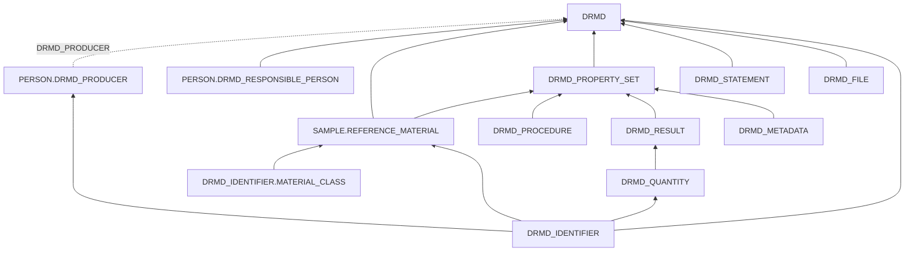

# Digital Reference Material Documents (DRMD)

A Digital Reference Material Document (DRMD) is the machine-readable form of the documents that [ISO 33401:2024](https://www.iso.org/standard/84222.html) requires for reference materials: the **reference material certificate** of a certified reference material (CRM) and the **product information sheet** of a reference material (RM). Its XML structure is defined by the DRMD schema 1.0.0, which builds on the Digital Calibration Certificate (DCC) and the D-SI format for values and units.

The definitions in `bam_masterdata/datamodel/v0/drmd/` describe the content of such a document as openBIS objects. The content can then be kept next to the material and the measurements it is based on, and a DRMD can be generated from it. Reading and writing the XML, and checking the business rules of the schema, belong to the DRMD parser `drmd-parser`, a separate package built from the [parser template](../howtos/parsing/create_new_parsers.md).

## Object types

| Object type | Content | XML element |
| --- | --- | --- |
| `DRMD` | The document: type, identification, validity, producer and the statements required by ISO 33401 | `drmd:digitalReferenceMaterialDocument` |
| `PERSON.DRMD_PRODUCER` | Producer organisation and its contact point | `drmd:referenceMaterialProducer` |
| `PERSON.DRMD_RESPONSIBLE_PERSON` | Person responsible for the document, with role | `dcc:respPerson` |
| `SAMPLE.REFERENCE_MATERIAL` | The material described by the document | `drmd:material` |
| `DRMD_IDENTIFIER` | Identifier given as scheme and value, e.g. DOI, ROR, CAS number, batch number | `drmd:documentIdentifier`, `drmd:organizationIdentifier`, `drmd:materialIdentifier`, `drmd:propertyIdentifier` |
| `DRMD_IDENTIFIER.MATERIAL_CLASS` | Classification of the material | `drmd:materialClass` |
| `DRMD_PROPERTY_SET` | Block of certified or informative property values | `drmd:properties` |
| `DRMD_RESULT` | One result of a block, typically a value or a table | `drmd:result` |
| `DRMD_QUANTITY` | Value with D-SI unit, quantity kind and measurement uncertainty | `drmd:quantity`, `dcc:itemQuantity`, `dcc:usedMethodQuantity` |
| `DRMD_PROCEDURE` | Measurement procedure | `dcc:usedMethod` |
| `DRMD_METADATA` | Measurement metadata, e.g. traceability or a non-SI unit | `dcc:metaData` |
| `DRMD_STATEMENT` | Further statement without a dedicated element | `drmd:statement` |
| `DRMD_FILE` | File embedded in the document, e.g. the PDF rendition | `drmd:document`, `dcc:file` |

The seven controlled vocabularies (`DRMD_DOCUMENT_TITLE`, `DRMD_VALIDITY_TYPE`, `DRMD_VALUE_TYPE`, `DRMD_QUANTITY_ROLE`, `DRMD_UNCERTAINTY_TYPE`, `DRMD_CONFORMITY` and `LANGUAGE`) are defined in `vocabularies.py`.

## How the objects are linked

Elements that occur once in the document are properties; elements that can repeat are objects. Each part of the document is an openBIS **parent** of the object that contains it, the same direction as sample → measurement elsewhere in the BAM datamodel. The producer, which is the same for many documents, is referenced by the object property `DRMD_PRODUCER`.

Quantities can also be parents of a reference material (minimum sample size, item quantities) or of a procedure (method quantities); `DRMD_QUANTITY_ROLE` states which. A value given in several units (`si:hybrid`) or as a list (`si:realListXMLList`) is one quantity whose members are parent quantities.

## Design decisions

**One datamodel for both document types.** A certificate and a product information sheet have the same structure; ISO 33401:2024, Table 1 only changes which content is required. `DRMD_DOCUMENT_TITLE` states the type. Properties required in both documents are mandatory in openBIS; requirements that depend on the type, such as metrological traceability for certificates, are checked by the parser with the business rules of the DRMD schema.

**The datamodel describes the content, not the XML.** The XML attributes that name, link or classify elements within the file (`@id`, `@refId`, `@refType`) and the order of repeated elements are not stored. The parser creates the identifiers it needs, derives references from the parent links (for example the link from a property set to its material), and writes repeated elements in the order in which the objects were created. None of the business rules of the schema depends on these attributes.

**Producer and responsible persons extend `PERSON`.** Both share the properties of `PERSON` (name, affiliation, email, telephone). For the producer, `AFFILIATION` holds the producer organisation and `$NAME` the contact point, which may be a department, so `FAMILY_NAME` is optional there. The schema requires a postal address of the producer and the DRMD guidance gives it in parts, so the producer has `STREET`, `STREET_NUMBER`, `POSTAL_CODE`, `CITY` and `COUNTRY_CODE` (ISO 3166-1); the free-text `ADDRESS` of `PERSON` is not written to the document. `HOMEPAGE` completes the contact. A responsible person adds `ROLE` and `DRMD_MAIN_SIGNER`.

**The material class extends the identifier.** A class within a classification is described like an identifier within a scheme: `DRMD_SCHEME` names the classification and `DRMD_IDENTIFIER_VALUE` holds the class. The separate type tells the two lists of the material apart.

**The reference material is a sample.** `SAMPLE.REFERENCE_MATERIAL` extends `SAMPLE`, so the material described in the document is the same object that production, homogeneity and stability measurements refer to.

**Reuse and naming.** Existing property types (`$NAME`, `DESCRIPTION`, `UUID`, `VERSION`, `DATE_EXPIRATION`, `HOMEPAGE`, `REFERENCE` and the properties of `PERSON` and `SAMPLE`) are assigned with their existing definition. New property types describe general concepts without a prefix (`LANGUAGE`, `ROLE` and the address parts such as `CITY`), while properties whose meaning comes from the DRMD, DCC or D-SI schemas start with `DRMD_`. New definitions are in English.

**Vocabularies.** Term codes are stable openBIS codes and labels are readable names. The value the schema uses (for example `conditionalPass` or `si:realListXMLList`) is given in the description of each term; the parser maps term codes to these values.

**One language per document.** `LANGUAGE` states the language of all texts of a document; the parser writes it as `@lang` on each text element. Documents in several languages are not covered.

**Files are datasets.** A `DRMD_FILE` object carries the name and media type that the schema requires; the file itself is a dataset of the object. As a parent of the document it is an embedded document such as the PDF rendition, as a parent of a statement it belongs to that statement.

**Ontology references.** Object types refer to IAO, OBI and BFO terms in `iri` where a term fits, `DRMD` also refers to ISO 33401:2024, and `DRMD_QUANTITY_KIND` refers to the QUDT quantity kinds it names.

## Scope

The datamodel covers the content of reference material certificates and product information sheets. It does not cover complex values (`si:complex`), multivariate uncertainties, texts in several languages, or the digital signature (`ds:Signature`), which is created when the generated document is signed.
