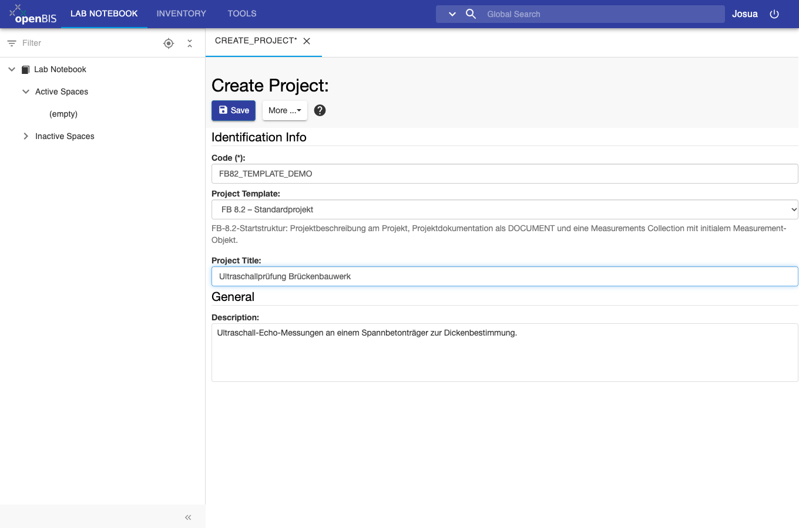
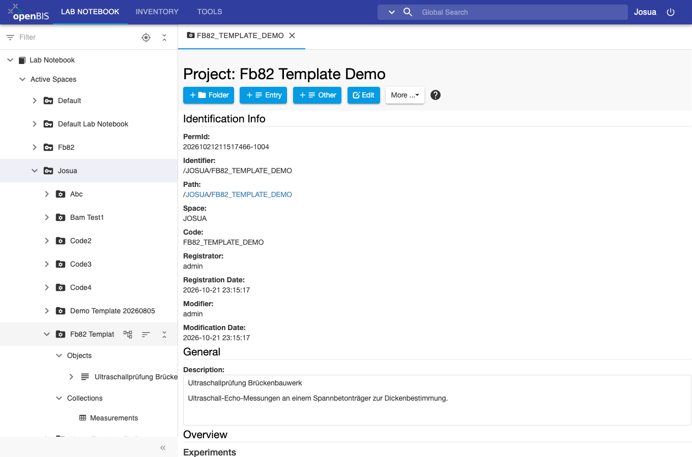
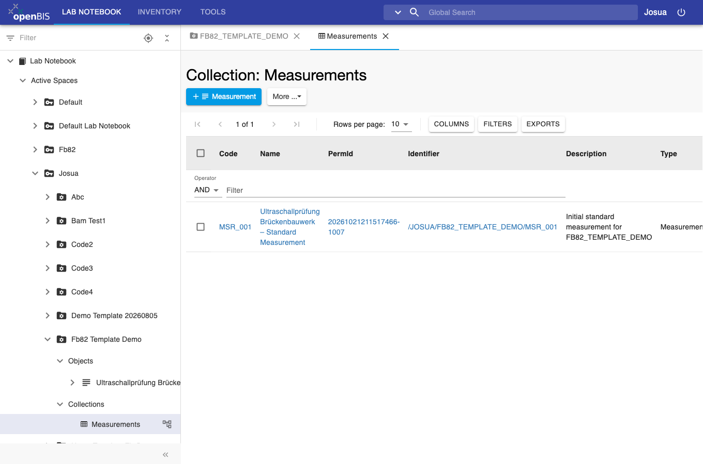

# Project templates for the ELN (proposal)

An ELN plugin that adds a template choice to the normal **New Project** form.
With a template selected, saving creates the project together with an agreed
starting structure in one step. Without a template the ELN saves as usual.

Built for FB 8.2; the template catalog is generic, so other departments could
add their own templates.

**Status:** proposal, tested only on a local openBIS 20.10.12 instance. Not
deployed anywhere.

| 1. New Project form | 2. Created project | 3. Created structure |
| --- | --- | --- |
|  |  |  |

## What it creates (FB 8.2 template)

- the project; title and description go into the native project description,
- a `DOCUMENT` for the project documentation,
- a `MEASUREMENTS` collection with an initial `MEASUREMENT`.

Everything is created in one `executeOperations()` call, so nothing is left
behind if a step fails.

## Security model

- **ELN plugin only.** It uses the documented `ELNLIMSPlugin` API
  (`afterViewPaint` for the project form). No ELN files are changed, and there
  is no custom AS service, Jython or other server-side code.
- **User's own session.** It uses the ELN's V3 API client with the logged-in
  user's session. openBIS checks every operation, so the plugin cannot do
  anything the user could not already do.
- **Create operations only.** The adapter builds only `CreateProjectsOperation`,
  `CreateExperimentsOperation` and `CreateSamplesOperation`.
- **Templates are data, not commands.** `templates.json` is validated against an
  allowlist of types, property codes and placeholders in `template-catalog.js`.
  A JSON change alone cannot add types or operations. A template code changed in
  the browser is rejected.
- **Text stays text.** The title is HTML-escaped and the description sanitized
  with the ELN's DOMPurify before they are stored as rich text.

Remaining risk: a malicious change to the deployed JavaScript could misuse the
user's session, so installation and updates need review and controlled write
access to the ELN plugin folder.

## Files

| File | Purpose |
| --- | --- |
| `eln-plugin/plugin.js` | form integration and save handling |
| `eln-plugin/template-catalog.js` | validation, allowlist, placeholders, creation plan |
| `eln-plugin/openbis-adapter.js` | the only openBIS V3 integration point |
| `eln-plugin/templates.json` | released templates |
| `verification/verify_eln_plugin.js` | offline tests (injection payloads, allowlist, single transaction, static checks) |

## Installation

1. Copy `eln-plugin/` to
   `servers/core-plugins/eln-lims/1/as/webapps/eln-lims/html/plugins/bam-project-templates/`.
2. Add `"bam-project-templates"` to `PLUGINS_CONFIGURATION.extraPlugins` in the
   ELN's `etc/config.js`.
3. Reload the ELN.

## Tests

```bash
node tools/openbis-plugins/bam-project-templates/verification/verify_eln_plugin.js
```

Also checked by hand against a local openBIS 20.10.12 instance: creation with
and without a template, a template code changed in the browser, HTML in the
title, and a duplicate project code (error shown, existing project unchanged).

ELN 20.10 sometimes leaves the New Project form empty, because it shows the
form sections from an async callback that can run too early. The plugin shows
those sections itself.
